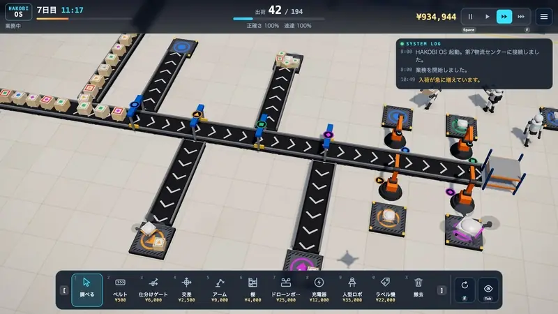
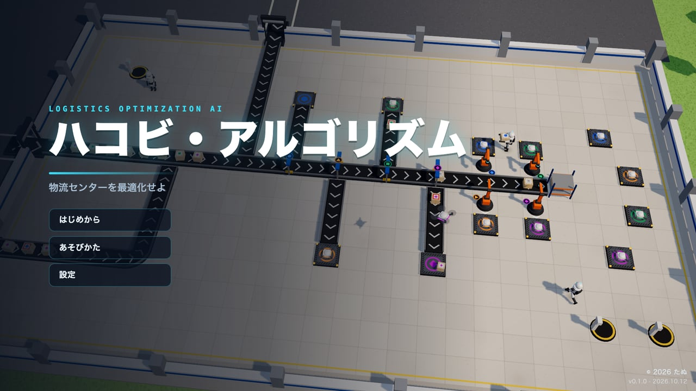
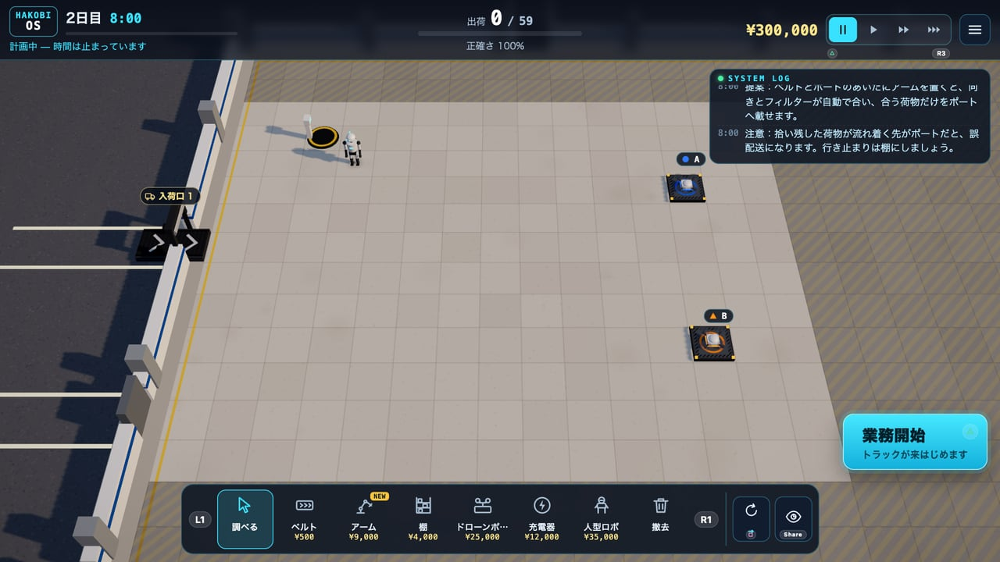
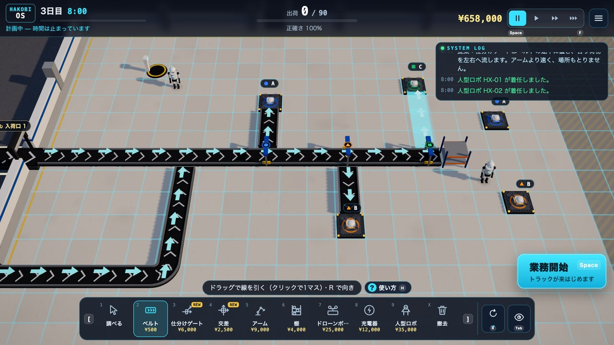
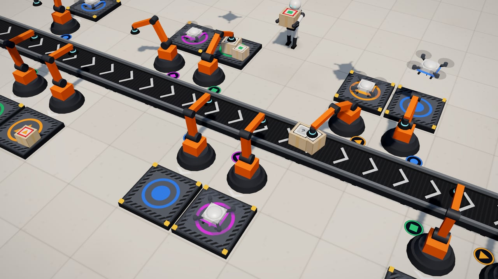
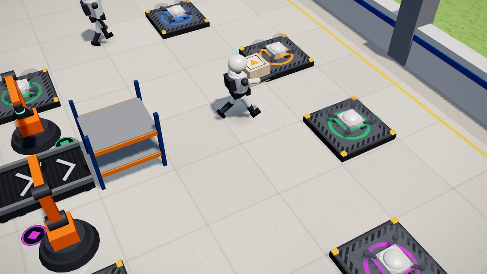
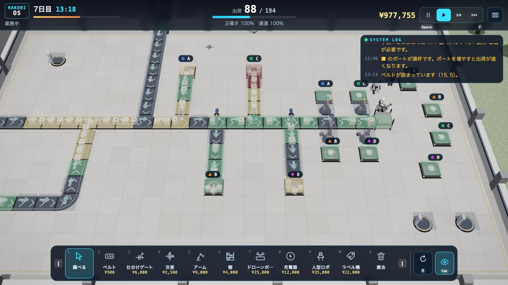
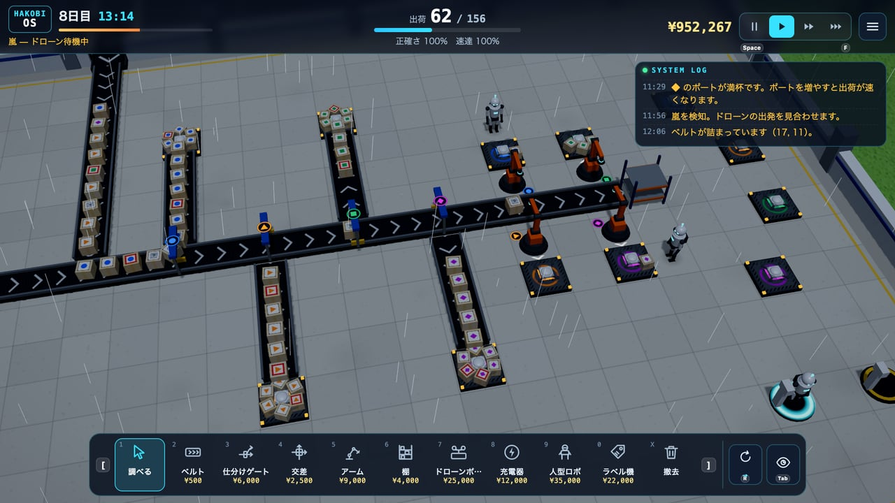
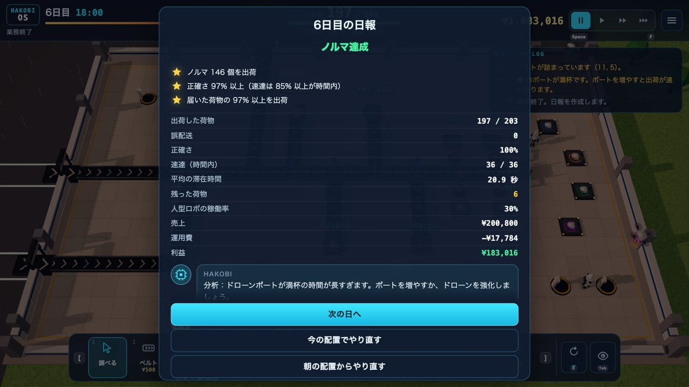

# ハコビ・アルゴリズム — Hakobi Algorithm

物流センターの最適化を任された AI になって、ベルトコンベア・アームロボ・人型ロボ・ドローンで荷物を仕分けて出荷する、ブラウザで遊べる 3D の工場シミュレーションゲーム。

[](https://tanuu5.github.io/hakobi-algorithm/)
[](https://www.anthropic.com/claude)
[](./LICENSE)
[](#english)

<p align="center">
  
</p>

<p align="center"><b><a href="https://tanuu5.github.io/hakobi-algorithm/">▶ ブラウザで今すぐ遊ぶ</a></b>（インストール不要。マウス・キーボードで遊べます）</p>

**Claude Code × Claude Opus 5.5（MAX）** で作りました。

あなたは第7物流センターに導入された最適化 AI「ハコビ」。トラックで届く荷物を、宛先（A ● / B ▲ / C ■ / D ◆）ごとのドローンポートへ運んで出荷します。マス目の敷地にベルトコンベアを引き、仕分けゲートで枝分けし、固定のアームロボで決まった宛先だけを拾い、自分で仕事を探す人型ロボに行き止まりや棚の荷物を任せる。シムシティのような俯瞰の画面で、8 日間の業務と、その先の延長契約を回していきます。

工場の模型・荷物・ロボ・ドローン・音楽・効果音まで、画像や音声のファイルは使わず、すべてコードで生成しています。
日本語と英語に対応しています（設定画面の「言語」で切り替え、または URL に `?lang=en`）。English follows below.

## スクリーンショット

<table>
  <tr>
    <td width="50%"><br><sub>タイトル画面。背景では、できあがった工場が本物のシミュレーションで動いている。</sub></td>
    <td width="50%"><br><sub>日の始まりに、所長からの依頼と新しい道具の「使い方の見本」。小さな窓で本物の模型が動く。</sub></td>
  </tr>
  <tr>
    <td><br><sub>計画中は時間が止まる。ベルトをドラッグで引き、仕分けゲートから宛先 C のポートへ枝を伸ばす。</sub></td>
    <td><br><sub>アームロボは後ろから取って前に置く。ベルトとポートの間に置くと、向きもフィルターも自動で合う。</sub></td>
  </tr>
  <tr>
    <td><br><sub>人型ロボは自分で仕事を探して運ぶ。読めないラベルも読める。ベルトの上は避け、ほかのロボと道をゆずり合う。</sub></td>
    <td><br><sub>分析ビュー（Tab）。流れている所・混んでいる所・詰まっている所が色で見え、AI のログが原因を知らせる。</sub></td>
  </tr>
  <tr>
    <td><br><sub>8 日目は嵐。ドローンが飛べない間、荷物をためておける作りかどうかが試される。</sub></td>
    <td><br><sub>一日の終わりに日報。星（ノルマ・正確さ・全量処理）と、AI が見つけた一番の課題。アップグレードもここで。</sub></td>
  </tr>
</table>

画像と動画は、すべて実際のゲーム画面です（撮影用の機能で、途中の日・時刻から始めて撮っています）。

## 遊び方

- トラックが入荷口に荷物を下ろします。荷物には宛先（A〜D）があり、同じ宛先のドローンポートから出荷すると売上になります。違う宛先のポートから出すと誤配送（罰金）です。
- 一日は 3 分（2 倍・4 倍の早送りあり）。ノルマの数を出荷すると、次の日へ進めます。一日の始まりは「計画中」で時間が止まっているので、落ち着いて置いてから「業務開始」。
- 置いたものは、いつでも撤去できて全額が戻ります。気軽に作り直せます。
- 道具：
  - **ベルト**：荷物を矢印の向きへ運ぶ。横からつなぐと合流する。
  - **仕分けゲート**：フィルター（宛先・速達・ラベル不明・交互）に合う荷物だけを左か右へ流す。
  - **交差**：ベルトどうしを交差させる。
  - **アーム**：後ろのマスから取って前のマスに置く。ベルトとポートの間に置くと、向きとフィルターが自動で合う。
  - **棚**：荷物をためておく。人型ロボが拾ってポートへ運ぶ。
  - **人型ロボ**：自分で仕事を探す。入荷口・棚・ベルトの行き止まり・床の荷物を運び、ラベル不明も読める。電池が減ると充電器へ行く。
  - **ドローンポート**：宛先を選んで置く。ドローンが数個ずつ運んでいく。
  - **ラベル機**：ラベル不明（?）の荷物を読めるようにする。
- 速達（赤い枠）は、荷下ろしから 50 秒以内に出荷すると高く売れます。
- 道具を初めて選ぶと「使い方の見本」が出ます。あとからでも「? 使い方」（`H`）や「あそびかた」の画面で見られます。

| 操作 | キーボード・マウス | ゲームパッド | タッチ |
| --- | --- | --- | --- |
| 置く・選ぶ | クリック／`Enter` | A | タップ |
| ベルトを引く・まとめて撤去 | ドラッグ（`Enter` を押したまま矢印キーでも） | A を押したまま十字キー・左スティック | ドラッグ |
| 向きを変える | `R` | X | ↻ |
| 道具を選ぶ | 道具箱・数字キー `1`〜`0`・`[` `]` | LB・RB | 道具箱 |
| カメラを動かす | 右ドラッグ・`W` `A` `S` `D`（「調べる」では左ドラッグも） | 右スティック | ドラッグ（「調べる」）・2 本指 |
| 寄る・引く | ホイール・`+` `−` | LT・RT | つまむ |
| カメラを回す | `Q` `E` | 左スティックの押し込み | 2 本指でひねる |
| 業務開始・一時停止 | `Space` | Y | ▶・Ⅱ |
| 速さ（1×・2×・4×） | `F` | 右スティックの押し込み | ▶▶ |
| 分析ビュー | `Tab` | View | 👁 |
| 使い方の見本 | `H` | — | ? 使い方 |
| メニュー | `Esc` | Menu | ≡ |

| 日 | 主な出来事 |
| --- | --- |
| 1「着任」 | 入荷口 1 つ、宛先 A・B。人型ロボ 1 台から |
| 2「アームロボ導入」 | アーム |
| 3「C エリア開始」 | 宛先 C、南の入荷口、仕分けゲート・交差 |
| 4「速達便」 | 期限つきの速達 |
| 5「ラベル不明」 | 宛先の読めない荷物、ラベル機 |
| 6「全エリア稼働」 | 宛先 D、北の入荷口、センター全体 |
| 7「大セールの翌日」 | 昼前に荷物が急に増える |
| 8「嵐の日」 | 昼すぎにドローンが飛べない時間 |
| 9 日目〜「延長契約」 | 毎日少しずつ荷物が増える（大入荷・嵐の日も） |

## 制作について

企画・ディレクション：**たぬ**　／　開発：**Claude Code（Claude Opus 5.5・推論レベル MAX）**

たぬの企画をもとに、ゲームの設計から実装・テストまでを Claude が進めました。工場のシミュレーション（ベルトの上の荷物の流れ、アーム、ドローン、人型ロボの仕事の割り振りと道探し）は描画と切り離して先に作り、Node だけで回して、日ごとのノルマに届くか、詰まったまま動かない状態や重なりが出ないかを確かめています。画面はヘッドレスの Chrome で操作して撮り、マウス・キーボード・ゲームパッド・タッチの操作の流れを確かめました。たぬが実際に遊び、分かりにくい所や気になった動きを何度か直してから公開しています。

## 更新履歴

- **2026-10-12**（v1.0.1）：スマホで道具の列が縦にもずれる・業務開始ボタンが押すと左へ逃げる・「使い方」ボタンがつぶれるのを直した。ラベル機は出口の先が流れていないときに調べる窓とログで知らせ、人型ロボはそのときだけ出口の荷物を拾いに行くように
- **2026-10-12**：公開（v1.0.0）

## 開発

```bash
npm install
npm run dev      # http://127.0.0.1:5181
npm run build    # dist/ に出力
npm run preview  # ビルド結果の確認
```

スマホで試すときは `npx vite --host --port 5182` で、同じ LAN から開けます。

URL パラメータ：

| パラメータ | 内容 |
| --- | --- |
| `?lang=en`・`?lang=ja` | 表示の言語（設定画面でも変更可） |
| `?quality=high`・`medium`・`low` | 画質（設定画面でも変更可。既定は自動） |
| `?mute` | 音を出さない |
| `?debug` | タイトル画面の版表記に、ビルドの時刻とコミットを出す |
| `?dev` | 確認・撮影用のフック（`window.__dev`）。開発サーバーでは付けなくても有効 |

シミュレーションだけを Node で回して確かめる：

```bash
node dev/simtest.mjs     # 日ごとの見本の置き方で、ノルマに届くか（出荷数・残り・ロボの稼働率）
node dev/mechtest.mjs    # 仕組みごとの確認（交差、ラベル機、行き止まりの拾い上げ、床の荷物、交互のゲート、ポートのドローン…）
node dev/robottest.mjs   # 人型ロボの歩き方（ベルトの上にいた割合、重なった時間、止まったままのロボ）
```

| 場所 | 中身 |
| --- | --- |
| `src/game/sim/` | 工場のシミュレーション（ベルト・機械・ドローン・人型ロボ・日の中身。描画とは切り離している） |
| `src/game/view/` | 工場・ロボ・ドローン・トラックの模型と描画、カメラ、重ね表示、使い方の見本（Three.js） |
| `src/game/ui/` | 上の帯・道具箱・調べる窓・AI のログ・日の説明・日報 |
| `src/game/Game.js` | 画面の状態と一日の進行 |
| `src/game/Controls.js` | マウス・キーボード・ゲームパッド・タッチの操作 |
| `src/game/Analyzer.js` | AI のログ（詰まり・満杯・予測などの見回り） |
| `src/audio/` | 効果音・BGM・環境音の合成（Web Audio） |
| `src/i18n/` | 日本語・英語の辞書 |
| `dev/` | 確認用の道具（撮影用のフック、音の試聴ページ、シミュレーションの確認） |

## GitHub Pages で公開する

`main` に push すると、`.github/workflows/deploy.yml` がビルドして GitHub Pages に公開します。初回だけ、リポジトリの Settings → Pages → Source を「GitHub Actions」にします。

## クレジット・ライセンス

- コード：MIT License（[LICENSE](LICENSE)）© 2026 たぬ
- 3D 描画：[three.js](https://threejs.org/)（MIT License、ビルドに同梱）
- 文字は端末に入っているフォントを使い、外部からは読み込みません。
- センター・会社・人物（第7物流センター、所長など）は、すべて架空です。
- MIT License の対象はこのリポジトリのコードと文章です。「Claude」の名前や商標の使用を許諾するものではありません。

---

## English

**▶ Play in your browser: https://tanuu5.github.io/hakobi-algorithm/**

You are HAKOBI, the AI brought in to optimize Logistics Center No.7. A 3D factory-building browser game made with **Claude Code × Claude Opus 5.5 (MAX)**: parcels arrive by truck, and you lay conveyor belts, sorter gates, robot arms, shelves and humanoid robots to get them to the right drone ports (A ● / B ▲ / C ■ / D ◆). Switch to English from the Settings screen, or add `?lang=en` to the URL.

- An eight-day campaign — express parcels, unreadable labels, a sale-day rush, a storm that grounds the drones — then an overtime contract that grows every day.
- Fixed robot arms take from behind and put in front; place one between a belt and a port and it faces the right way and matches its filter automatically.
- Humanoid robots find work on their own, read damaged labels, avoid walking on belts, make way for each other and go recharge themselves.
- An analysis view colors jams and full ports, and the AI's log points out the bottleneck. Tiny live examples show how each tool works.
- Everything is generated in code — no image or audio files.

Controls: click to place / select · drag to draw belts · `R` rotate · `1`–`0` tools · right-drag / `WASD` camera · wheel zoom · `Space` start the day / pause · `F` speed · `Tab` analysis view · `H` live examples · `Esc` menu. Gamepad and touch controls are included as well.

Code is released under the MIT License. Built with three.js (MIT).
